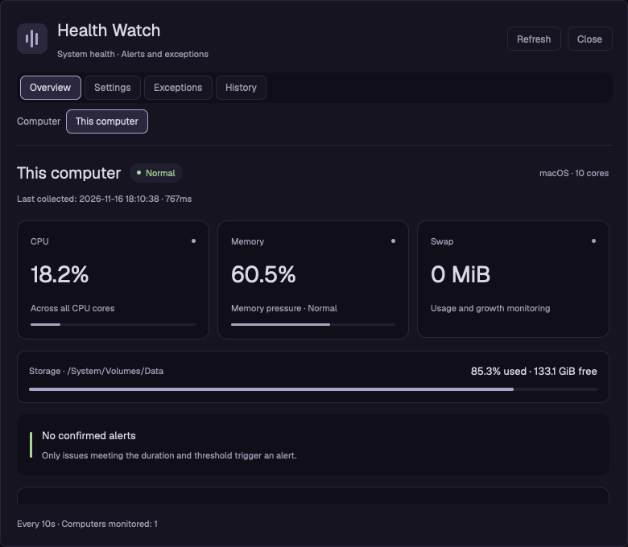

# Health Watch

A local-first desktop mod for Herdr: CPU, memory pressure, swap growth, storage, opt-in process monitoring, actionable alerts, scoped exclusions and a bounded event history. No cloud account, credentials, layout or theme is included.

[Download releases](https://github.com/ananjaemin/herdr-health-watch/releases) · [Browse screenshots](#screenshots)



## Screenshots

Native Herdr captures at **780 × 680**, using live local measurements and default settings. Personal history, exceptions, process lists and the surrounding desktop are not included. Colors inherit the host theme; no theme is distributed.

| Language | Overview | Settings | Exceptions | History |
| --- | --- | --- | --- | --- |
| English | [View](screenshots/en/overview.png) | [View](screenshots/en/settings.png) | [View](screenshots/en/exceptions.png) | [View](screenshots/en/history.png) |
| 한국어 | [현황](screenshots/ko/overview.png) | [설정](screenshots/ko/settings.png) | [예외](screenshots/ko/exceptions.png) | [기록](screenshots/ko/history.png) |
| 日本語 | [概要](screenshots/ja/overview.png) | [設定](screenshots/ja/settings.png) | [例外](screenshots/ja/exceptions.png) | [履歴](screenshots/ja/history.png) |
| 简体中文 | [概览](screenshots/zh-CN/overview.png) | [设置](screenshots/zh-CN/settings.png) | [例外](screenshots/zh-CN/exceptions.png) | [历史](screenshots/zh-CN/history.png) |


## Compatibility and limits

- GUI host exercised: **macOS ARM64, Herdr 0.1.16**. Herdr supplies QuickJS, `herdr`, `gpui-kit` and `gpui-base`; Node/Bun globals are not runtime dependencies.
- Probe implementations support macOS and Linux. **Remote Linux has not been live-tested. Windows is unsupported.** A supported probe does not establish GUI compatibility on other hosts.
- Python **3.9+**, standard library only, is required for the installer and ZIP builder. Bun is a development test runner only; no dependency installation is needed for the shipped mod.
- Vitals **0.3.1** is an external, pinned collector. It is **not bundled, automatically downloaded, or run by the installer**. The platform-specific release pins are in [`dependencies.json`](dependencies.json); an unlisted OS/architecture cannot install a collector through this script.
- Languages: English (`en`), Korean (`ko`), Japanese (`ja`) and Simplified Chinese (`zh-CN`). Settings offers `auto` OS-language detection and explicit overrides; unsupported locales and missing translations fall back to English. Traditional Chinese is not claimed. New structured history events render in the selected language; older recorded messages retain their original language. Raw OS/tool diagnostics can remain in the tool's language.
- Polling exists only while a Health Watch view is alive. An open panel is not an always-on service; closing its last view or quitting Herdr stops monitoring. Installing the files alone does not start monitoring.

## Install

Review the source and [dependency notices](THIRD_PARTY_NOTICES.md) first. Do not run these commands with `sudo`. Run from the extracted release root.

### Mod only

```sh
python3 scripts/install.py --app-home "$HOME/.config/herdr-app" --data-home "$HOME/.local/share/herdr-health-watch"
```

Without a ready collector this succeeds with an actionable warning, **not** a claim that monitoring works.

### Add the pinned collector explicitly

Manually obtain the matching archive from the [official Vitals 0.3.1 release](https://github.com/mrolafsson/herdr-vitals/releases/tag/v0.3.1) after reviewing its license and provenance. Keep the original archive; do not unpack/repack it or substitute a build. Supply its local path (quotes support spaces):

```sh
python3 scripts/install.py --app-home "$HOME/.config/herdr-app" --data-home "$HOME/.local/share/herdr-health-watch" --vitals-archive "/path/to/official-vitals-archive.tar.gz"
```

If you already installed the mod, add `--upgrade`. The installer verifies the archive against the pinned manifest, rejects unsafe archive members, copies only `herdr-vitals`, and never executes it. A checksum file placed next to an arbitrary archive is not trusted. Existing differing dependencies/configuration are refused, not replaced.

Runtime reads exactly:

```text
~/.local/share/herdr-health-watch/
  vitals/0.3.1/herdr-vitals
  config/config.json
  home/
  state/
  terminal-notifier          # optional user-installed executable symlink
```

The installer writes exactly this JSON without a trailing newline. Existing trailing LF bytes are accepted, matching the runtime's POSIX command substitution; other whitespace or changes are rejected.

```json
{"background":false,"alerts":false,"ai_alerts":false,"herdr_machines":false,"local":true,"interval_seconds":10}
```

The collector receives an isolated `HOME`, `HERDR_PLUGIN_CONFIG_DIR` and `HERDR_PLUGIN_STATE_DIR`, a cleared environment, fixed system-tool `PATH`, and `LC_ALL=C`. It is called as a one-shot reader, not a Vitals background service. `--data-home` accepts overrides **only for isolated installer QA**: the runtime still uses the fixed home-relative path above on each selected machine. Moving collector data elsewhere does not configure the runtime.

### Open without changing your layout

After installation, use Herdr's command palette to open the `health-watch` mod, or explicitly run:

```sh
herdr-app do mod.open --name health-watch
```

This opens the 780 × 680 dialog; it does not replace a layout or bind keys. A mod tab can instead be opened explicitly:

```sh
herdr-app do tab.new --name "Health Watch" --mod health-watch --props '{"view":"panel"}'
```

The source also supports `props.view: "bar"`, `props.machine` and an initial `props.tab` (`overview`, `settings`, `exceptions`, `history`) for a user's own composition. No layout integration is installed or required for the dialog. Do not edit an existing layout merely to try the mod.

### Optional desktop notifications

macOS uses separately user-installed `terminal-notifier` discovered through standard Homebrew locations/PATH or this explicit link option:

```sh
python3 scripts/install.py --upgrade --app-home "$HOME/.config/herdr-app" --data-home "$HOME/.local/share/herdr-health-watch" --notifier "/absolute/path/to/terminal-notifier"
```

`--notifier` must point to an existing executable. It creates only the optional link under the isolated data home, never copies or installs that third-party application and never replaces a differing existing link. Linux uses separately user-installed `notify-send` and a working desktop notification service; clicks and sound are not guaranteed there. OS notification authorization may be required; use the mod's test-notification control and check its delivery result. An accepted send request does not prove the OS displayed it. Critical sound is opt-in on macOS. macOS notification clicks reopen Health Watch through a discovered `herdr-app` CLI when available, otherwise only open Herdr. Missing notification tools do not disable in-app alerts/history.

### Remote targets

Select remote machines explicitly in Settings; they are not enrolled automatically. Each target must already be registered and reachable through Herdr and have Vitals 0.3.1 and the exact isolated config under **that remote user's home**. Provision it yourself on the remote host only after authorization; this installer does not SSH, pair machines, copy credentials, or install remotely. Herdr executes bounded read-only probes on selected targets using its existing machine connection. Remote Linux live behavior remains unverified.

## Upgrade, removal and rollback

Existing `mods/health-watch` is a conflict by default. To replace it deliberately:

```sh
python3 scripts/install.py --upgrade --app-home "$HOME/.config/herdr-app" --data-home "$HOME/.local/share/herdr-health-watch"
```

The old **mod directory only** is renamed to `APP_HOME/mod-backups/health-watch-<UTC timestamp>`. The replacement is staged from an explicit source allowlist. No shared configuration, history, other mods, keys, layouts or themes are overwritten. Missing dependencies still generate a warning. The script does not kill/restart Herdr, terminals or active sessions; close only Health Watch views before changing its files, then reopen them. No whole-app restart is required by this installer.

Remove by renaming the mod to a timestamped backup, preserving data and dependencies:

```sh
python3 scripts/install.py --remove --app-home "$HOME/.config/herdr-app" --data-home "$HOME/.local/share/herdr-health-watch"
```

Rollback by substituting the exact backup **basename** printed by the installer (not a full path):

```sh
python3 scripts/install.py --restore-backup "health-watch-<UTC timestamp>" --app-home "$HOME/.config/herdr-app" --data-home "$HOME/.local/share/herdr-health-watch"
```

If a current mod exists, add `--upgrade` to back it up first. Restore moves only the selected mod backup; it does not roll back shared configuration/state. There is no automatic deletion or dependency uninstall. Retained mod backups may contain your old customized source; keep them private. Any later data/dependency cleanup is a separate, manually reviewed operation.

## Scope and permissions

| Surface | Exact scope |
| --- | --- |
| Installer writes | `APP_HOME/mods/health-watch`, temporary staging beneath `APP_HOME/mods`, and mod-only backups beneath `APP_HOME/mod-backups`; dependency files under the explicit data home only when a local archive/notifier is supplied |
| Never edited by installer | `shared.json`, `keys.json`, layouts, themes, other mods, machine registration, shell files, system services, Herdr binaries, or active terminal sessions |
| Runtime persistence | Herdr `shared` / `setShared` entries prefixed `health-watch.`: configuration, state/history, sampling lease, delivery and errors; these may be stored in the host's shared state, retained across upgrade/removal |
| Measurements | CPU, memory/pressure, swap, disk mounts/free space; `uname`, `sysctl` (macOS), `/proc/meminfo` (Linux), `df`, and opt-in/on-demand `ps` process metadata (PID, executable basename, CPU and RSS), not process contents or environment |
| Locale discovery | Cached local OS language from macOS `defaults read -g AppleLanguages`, or Linux `LC_ALL` / `LC_MESSAGES` / `LANG`; no preference changes |
| Processes | On-demand top process listing, or explicitly configured exact executable basenames; process exclusions do not suppress system CPU/memory rules |
| Notifications | Local OS desktop notifications, optional macOS critical sound, and explicit notification-click activation of Herdr/Health Watch; no email, webhook, cloud API or credential lookup |
| Network | No mod-owned cloud requests/downloads; only the user's explicitly selected Herdr machine connections for remote probes |

Use an ordinary user account. No elevated permissions or accessibility/screen-recording access is required by the mod. A machine's normal OS process visibility and notification rules still apply. Installation roots are explicitly chosen; symlinked protected destination subpaths and symlinked package source files are refused. The installer is not a sandbox for malicious modifications to the source package: review the package and its pinned manifest together.

## Build a local release, without publishing

```sh
python3 scripts/package.py --output dist
```

Produces `dist/herdr-health-watch-1.0.0.zip` and its `.sha256` sidecar, refusing existing outputs. The archive contains root docs/license/notices/manifest/metadata, `preview.png`, 16 cropped screenshots, installer/builder helpers, and the runtime `mods/health-watch` allowlist. It excludes tests, development SDKs, dependency binaries, layouts/themes, keys, personal state/config, and uncropped screenshots. Use `--output dist/gallery` when preserving an earlier local build. The builder requires real PNG assets; maintainers must review their contents before publishing.

[Herdr gallery guidance](https://herdr.dev/gallery/) calls for root `RECIPE.md`, `preview.png`, and the mod folder, with repository topic `herdr-mod`. [`RECIPE.md`](RECIPE.md) is the rebuild brief. The build/install scripts never publish or download anything. Public source and downloadable ZIP releases are maintained separately on GitHub.

## Verification status

Verified on **2026-11-16**, macOS ARM64 / Herdr 0.1.16:

- Runtime/locale suite: **67 passed, 0 failed**; subsequent native notifier symlink regression: **1 passed, 0 failed** (68 distinct tests).
- Installer suite: **11 passed**; subsequent trailing-LF compatibility regression: **1 passed** (12 distinct tests). No live data used by these tests.
- Standalone UI interaction smoke: all four locales × four tab render trees; language save/cancel, Auto/unsupported fallback, translated placeholders, retained input values and numeric validation passed.
- Native Herdr preview: all four locales × four tabs captured at 780 × 680; unsupported `de-DE` rendered English. Preview used copied local readings and in-memory settings, not modified monitoring preferences. Native preview and final installed mod both passed `herdr-app check`; live runtime reported no errors.
- Official pinned macOS ARM64 archive installed into temporary spaced-path homes; checksum verification and an isolated real one-shot collector read succeeded. The installer itself never executed the binary.
- Local mod-only upgrade retained the user's active layout/theme/keys and sessions, with previous mod directories backed up. Auto locale detected Korean and live measurements populated.
- Final portable macOS notification helper sent a Korean test; `terminal-notifier -list herdr-health-watch:test` showed a new OS registration timestamp. A discovered symlink must be resolved to the native app-bundle executable before execution; this is regression-covered.

Limits: no remote-machine or Linux desktop live QA; no automated native mouse/keyboard exercise of every control, OS banner-display/click confirmation, or professional translation review. Dates remain local numeric `YYYY-MM-DD HH:mm:ss`. One external-workspace `herdr-app check` timed out; checks within the installed mod directory subsequently passed.

Source checks and release builder:

```sh
bun test mods/health-watch
python3 -m unittest discover -s scripts -p 'test_*.py'
python3 scripts/package.py --output dist
```

The focused installer tests cover archive traversal/links, checksum rejection, spaced paths, conflict refusal, destination symlinks, and mod-only upgrade/removal/rollback preservation. They use temporary homes, never the live install. No dependency installation is required to run them. Test sources stay in the source repository and are excluded from the consumer ZIP.
