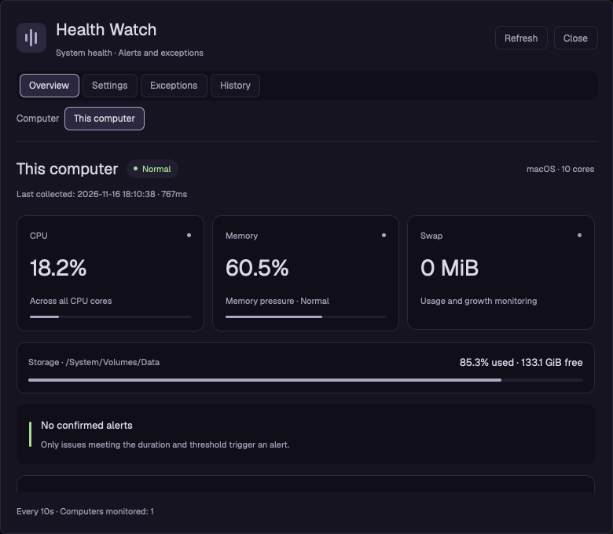

# Health Watch

A quiet system-health dialog for Herdr: select a machine, see CPU, memory, swap and storage, then acknowledge sustained warnings or scope an exception without hiding the original problem. Four tabs keep the live overview, settings, exceptions and recent history together. It uses the person's current Herdr theme and never brings a layout or theme of its own.

## What you see

- A **780 × 680 px** dialog at zoom 1. Outer surface padding is **20 px**, with **14 px** vertical gaps. All colors come from existing `theme()` values: `surface`, `background`, `foreground`, `muted`, `border`, `selected`, `accent`, `input`, and semantic `ansi1`/`ansi2`/`ansi3`. Do not substitute a hardcoded palette or edit the host theme.
- Top row: a **38 × 38 px**, radius-10 badge with three accent bars (**3 px** wide, **10/22/15 px** tall); “Health Watch” in **21 px semibold**, a muted **11 px** subtitle; Refresh and Close buttons at the right. Buttons are **30 px** tall, with **11 px** horizontal padding, **7 px** corners, **1 px** border and **12 px** type. Hover changes only the theme-derived button surface.
- Next: Overview, Settings, Exceptions and History in a rounded background tab strip; machine picker buttons on the next row. A one-pixel border-colored divider separates navigation from content.
- The middle scrolls vertically (nominal **474 px**, flex-shrinking to available height); navigation and footer stay outside the scroll. Sections use **16 px** padding, **12 px** gaps/corners and a one-pixel border. Ordinary text is **12 px**; supporting labels are **10–11 px**; section titles are **13 px semibold**.
- Overview: selected machine name and a semantic status chip, OS/core count and last successful collection time; stale/error/off warnings above retained metrics. CPU, MEMORY and SWAP are three equal **146 px**-high cards. CPU/memory get clamped horizontal meters; swap shows used bytes and growth-monitoring context. Disk rows show the mount, used percent and free bytes. Alert cards show level, rule/resource, localized message, acknowledgment and duration-scoped exception controls. Processes and notification delivery/testing follow below. Empty states say why there are no measurements or confirmed alerts rather than showing invented zeros.
- Settings: collection/notification toggles, language choice, explicit target selection, grouped numeric threshold fields, and exact process-basename enrollment. Inputs are **34 px** tall with stacked labels and fill their two-column cards. Dirty state and Save/Cancel controls live in the footer. Language choices are Auto, English, Korean, Japanese and Simplified Chinese; use English as the fallback, never pretend unsupported translations exist.
- Exceptions: machine, rule, optional resource, duration and reason form; then existing exclusions with their scope, reason, expiry and Delete control. Permanent exceptions require a reason. History: machine filters and a vertical timeline of new warning, escalation and recovery events, bounded to **200** total records. Recovery uses `ansi2`, critical `ansi1`, warning `ansi3`.
- The optional compact bar is a single inline machine/status/metric summary that opens the same dialog. It is available for a user's own composition; no bar-containing layout is shipped.

## How it behaves

- This is system health, not an agent-status dashboard: working/blocked/done/idle agent states are not tracked and do not animate or change this mod. Health states distinguish monitoring off, waiting, healthy, confirmed warning/critical, collection failures and stale samples; the last successful values remain visibly identified as old after failure.
- Pick a machine without silently enrolling it. Only saved target selections are monitored; remote machines and process basenames require explicit opt-in. The initial target is local, collection interval **10 seconds** (allowed integer **5–300 seconds**). A shared persisted lease/due time prevents duplicate collectors across multiple views. View scheduling is every five seconds; samples are not high-frequency animation. Refresh requests a collection without spawning an independent daemon.
- CPU warnings require a sustained threshold; default warn/clear are **90/80%**, hold **120 s**. macOS memory uses pressure; Linux uses default warn/critical **90/97%**, hold **30 s**. Swap growth defaults **256 MiB/min**, hold **60 s**. Storage defaults **90/97%** used or **20/5 GiB** free, hold **30 s**. Recovery holds **30 s**. Connection failures default to **3** consecutive failures. Explicit process CPU warnings default **50%**, hold **120 s**, normalized across all cores.
- Acknowledge marks an alert seen; it does not clear the condition. Exceptions apply only to the selected machine/rule/resource for **30 minutes**, **one hour**, **until local midnight**, or permanently. Permanent scopes require a nonblank reason. Expired exclusions are shown but no longer suppress. Deleting an exclusion restores that rule. Process exclusions never mute system CPU/memory alerts.
- Save applies a validated settings draft; Cancel restores the saved values. Invalid numeric ordering, ranges or process names display errors instead of partial saves. Process enrollment is an exact executable basename, not a path or wildcard. The process button fetches a bounded top-process list only on demand; automatic process reads occur only with explicitly watched basenames.
- Language is saved as `auto`, `en`, `ko`, `ja` or `zh-CN`; auto detects the OS locale once through the runtime boundary. Unsupported locales fall back to English. `zh`, `zh-CN`, `zh-SG` and `zh-Hans` resolve to Simplified Chinese; Traditional Chinese is not supported. New structured events re-render in the selected locale; old persisted event strings retain their recorded language. Raw external tool diagnostics are not promised translations.
- Notification toggles control local desktop requests, recovery requests and opt-in critical sound. A test control reports the send request result without claiming the desktop displayed it. macOS notifications can offer a route back to Health Watch using discovered Herdr CLI support; if that CLI is absent they only open Herdr. Linux requests do not guarantee clicks or sound; the in-app actions remain available.
- Clicking tabs changes content, not the host layout. Buttons have hover affordances and selected states. No custom global keys are installed. There are no decorative transitions or animated graphs. Closing the final Health Watch view or quitting Herdr stops its scheduling; install files do not create a service.

## Built from

- **No layout node tree, layout folder, theme assets, key snippet, other shipped mods or external artwork.** The hand-built badge uses three rectangles. Ship root `RECIPE.md` and cropped real `preview.png`, plus `mods/health-watch/` and the source distribution's safety/docs files.
- `mod.json`: `place: "none"`, title Health Watch, dialog overlay **780 × 680**. `main.js` is a `gpui-kit` View; `ui.js` composes `gpui-base` flex/div elements and existing `gpui-kit` inputs with theme values. `props.view` chooses `bar` or the default panel, `props.machine` selects a machine, and optional `props.tab` sets the initial valid tab.
- `engine.js`: pure config validation, measurements-to-alert state, hold/clear conditions, exclusions, escalation/recovery and bounded history. `runtime.js`: one owner for `health-watch.*` shared config/state/control/delivery/error entries, polling lease and public UI actions. `collector.js` executes bounded reads and parses them through `probe.js`. `i18n.js`, `ui-messages.js` and `system-messages.js` keep locale resolution/messages separate from presentation. `environment.js` owns environment/locale discovery; `notifications.js` and `notification-command.js` own portable notification command construction and delivery.
- Host API boundaries include `props`, `checking`, `machines`, `shared`, `setShared`, `exec`, `openOverlay`, `closeOverlay`, `nextCommand` and `cx` timers/spawn/notify. Public opening is `mod.open {name:"health-watch"}` or `tab.new {mod:"health-watch", props:{view:"panel"}}`; no layout/theme/keys commands are installed. A screenshot/checking render must not start probes.
- External collector: official **Vitals 0.3.1**, source commit `cfa895c75a23630cfc19727f820a4871d19df7b0`; pinned archives in `dependencies.json`. Runtime binary is `~/.local/share/herdr-health-watch/vitals/0.3.1/herdr-vitals` on **each selected machine**. Run `app '{"op":"now"}'` under cleared environment, isolated HOME/config/state, fixed system-tool PATH and `LC_ALL=C`. Exact config: `{"background":false,"alerts":false,"ai_alerts":false,"herdr_machines":false,"local":true,"interval_seconds":10}`. The probe checks this exact config before invoking the collector. Do not use upstream's downloading bootstrap or shared Vitals config.
- Probes use POSIX `sh`, standard `uname`/`df`/`ps`, macOS `sysctl`, or Linux `/proc/meminfo`; they never kill processes. Remote reads use only the selected Herdr machine connection and have bounded timeouts. Notification tools are separately user-installed macOS `terminal-notifier` or Linux `notify-send`; no executable is bundled, downloaded automatically or installed remotely.
- Root Python standard-library scripts build an explicit-allowlist ZIP and install only this mod. An optional local archive must match the pinned OS/architecture SHA256 before installation; unsafe archive paths/links are rejected and no newly installed binary is executed. Upgrade/removal rename only the mod to timestamped backups, preserving shared state, keys, layouts, themes, external data and active sessions. The root MIT license covers original Health Watch source; preserve upstream notices separately.

## Watch out

- Herdr is QuickJS, not Node/Bun. Host modules are not npm runtime packages. Tested GUI scope is macOS ARM64 Herdr **0.1.16** only; Linux probe support is not a claim of Linux GUI or remote live QA. No Windows support.
- The **780 × 680** panel and fixed card/input dimensions assume enough viewport space; do not promise mobile/responsive layout. Long translations and machine/resource labels must wrap or scroll rather than require a new theme/layout. Keep status visible when values are stale, off, or absent.
- Monitoring requires a live Health Watch view. Do not promise tray/background monitoring, push delivery, remote provisioning, automatic collector updates, an installed startup service, or periodic reads with the host closed.
- Vitals defaults are unsafe for this narrow use when config is missing: several features default on. Always retain the exact config gate and isolated home/config/state. One-shot upstream app reads can still write their isolated app-state files; do not call them filesystem-write-free. `--data-home` overrides are installer QA only, not runtime relocation support.
- Every target needs the pinned collector preinstalled under its own user's fixed path. Remote enrollment is explicit. Linux memory pressure is unavailable, so do not label a missing pressure reading healthy; retain percent-based rules.
- Notification send success is not receipt/display confirmation. External commands may emit untranslated diagnostics. Keep configuration, event history, machine names, dependency archives, OS credentials and uncropped windows out of the gallery package. Preview is the actual English mod cropped to its bounds, never a fabricated UI.

## Done when

These are acceptance checks to perform, not claims that this source preparation ran them:

1. In the supported host, open the mod without changing the user's layout, themes or keys. All four tabs render/scroll, Refresh and Close work, inputs/toggles save/cancel, and checking mode does not launch probes.
2. English, Korean, Japanese and Simplified Chinese choices persist after reopening; Auto follows supported OS locale detection and unsupported locales fall back to English. New events render in the selected language without rewriting old event strings.
3. Without a collector, the UI reports a real collection error and does not display invented health. With the reviewed pinned collector/config, local CPU/memory/swap/disk values populate. Stale/failure/off states keep old measurements explicitly marked.
4. Synthetic engine tests exercise sustained warning, escalation, acknowledgment, exclusions/expiry, consecutive failures and recovery, with history never above 200 events. Multiple views do not duplicate sampling/delivery.
5. On-demand processes are bounded; automatic process reads require explicit basenames. A process exception does not hide system CPU/memory warnings. Notification tests report actual request failure/success and missing tools remain usable in-app.
6. In temporary spaced-path homes, installer tests reject checksum mismatch/traversal/links, refuse an existing mod without `--upgrade`, preserve unrelated files on upgrade/removal/restore, and never run a supplied binary or use the live application home.
7. The explicit-allowlist release ZIP includes a real cropped English `preview.png`, 16 language/tab screenshots, root recipe/notices/license/manifest/docs/scripts and only runtime mod files; excludes layouts/themes, tests/SDKs, personal files and dependency binaries. The builder never publishes; GitHub publication is a separate authorized action.
